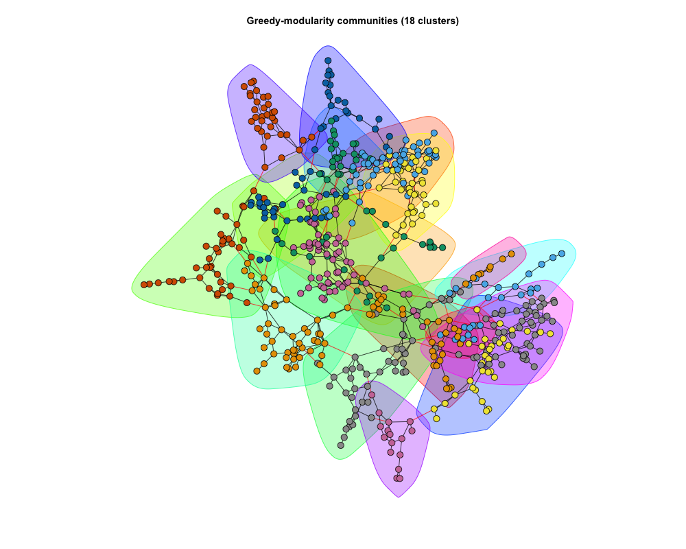
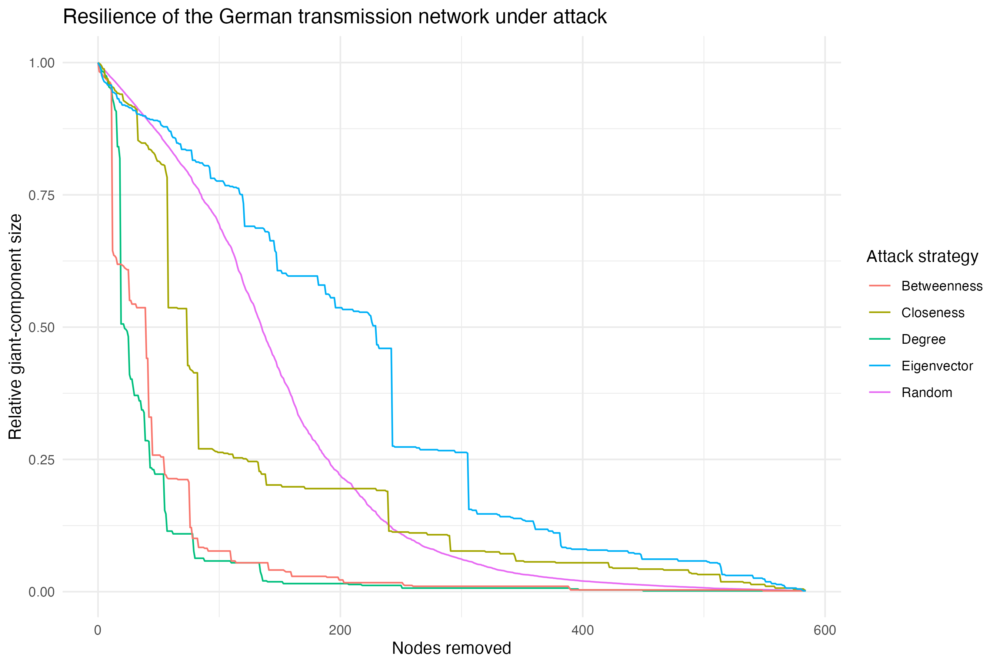

# Structural and Resilience Analysis of the German Transmission Network

**Group project for the course "Statistical Analysis for Network Data"**
Authors: **Patrick Poetto** and **Goar Shaboian**

> This repository contains an applied network-science study of the German
> high-voltage electricity transmission grid, analyzing its structural
> properties and simulating its resilience to random failures and targeted
> attacks.

## Problem

Modern electricity grids are critical infrastructure: the failure of a small
number of key substations or transmission lines can cascade into large-scale
blackouts. This project asks three questions about the German transmission
network:

1. Which nodes (substations, plants, generators) and links are structurally
   *critical* — i.e., their removal disproportionately disrupts the grid?
2. How does the grid's connectivity degrade under random failures versus
   *targeted* attacks on the most "important" nodes, and which notion of
   "importance" makes for the most effective attack?
3. What does the answer imply for where resilience-enhancement investment
   should be prioritized?

## Dataset

We use the **[SciGRID](https://www.scigrid.de/)** power-grid dataset, a
project funded by the German Federal Ministry of Education and Research.
SciGRID automatically derives a network model of the European transmission
grid from OpenStreetMap `power=*` tagging.

- **Nodes**: substations, power plants, and generators, represented by their
  geographic centroid.
- **Edges**: transmission lines, abstracted as simple links between nodes
  (not the real-world geographic path of the line).

### Data provenance (reproducibility note)

This repository originally referenced `data/scigrid_vertices.csv`,
`data/scigrid_edges.csv` and `data/germany_admin.geojson`, but those files
were never committed, so the analysis could not actually be run. During a
later reproducibility pass we tried to restore a runnable pipeline with real
data, in this order:

1. **Original source** (`https://www.power.scigrid.de/pages/downloads.html`):
   unreachable — the host's TLS handshake fails and the Wayback Machine
   snapshot is also blocked for automated access. The SciGRID project
   appears to be defunct as a direct download host as of November 2026.
2. **Substitute used (this is what the repo now contains)**: the same
   underlying SciGRID-Germany network (2016-era OSM extraction of the
   German extra-high-/high-voltage grid), redistributed as raw CSV by the
   **[PyPSA](https://github.com/PyPSA/PyPSA)** project at
   `examples/networks/scigrid-de/scigrid-de/`. We use:
   - `data/buses.csv` → graph vertices (585 substations, with real OSM
     names, coordinates and TSO operators — 50Hertz, Amprion, TenneT,
     TransnetBW).
   - `data/lines.csv` and `data/transformers.csv` → graph edges (852
     transmission lines + 96 intra-substation voltage-level couplings).
   - `data/germany_bundeslaender.geojson` → the 16 German federal-state
     boundaries, from the public
     **[isellsoap/deutschlandGeoJSON](https://github.com/isellsoap/deutschlandGeoJSON)**
     project, substituting for the original (never-included)
     `germany_admin.geojson`.

   This is **real public infrastructure data**, not a synthetic
   stand-in — only the redistribution channel changed (PyPSA mirrors and
   lightly cleans the same SciGRID extraction for power-system-modelling
   use), and a scale-free/synthetic fallback was not needed.
3. All numbers in **Key findings** below are the actual output of running
   `power_grid_resilience_analysis.R` against this data (R 4.5.2, igraph,
   sf, dplyr, ggplot2), not the originally-drafted (undemonstrated)
   figures.

**Preprocessing**: the vertex de-duplication / Germany-bounding-box filter
removes 0 rows on this dataset (all 585 vertices are unique and within
bounds) but is kept as defensive data-cleaning code. Parallel line
simplification collapses 948 raw edges (852 lines + 96 transformers) down to
801 after removing duplicate edges/self-loops.

## Methodology

The analysis is implemented in R using the **`igraph`** package, and
proceeds in the following stages (see
[`power_grid_resilience_analysis.R`](power_grid_resilience_analysis.R)):

1. **Graph construction and cleaning** — build an undirected graph from the
   SciGRID-derived vertex/edge tables and simplify it (remove duplicate
   edges and self-loops): 585 nodes, 801 edges.
2. **Connectivity / cohesion check** — with transformer couplings included,
   the graph is a **single connected component covering all 585
   substations** (`is_connected() == TRUE`). We verified this is sensitive
   to modelling choice: dropping the transformer edges (which link the
   different voltage-level "buses" PyPSA creates for one physical
   substation) fragments the graph into 13 components, with a giant
   component of only ~49% of nodes — an artifact of the data model, not of
   the real grid's redundancy. All analysis below uses the fully-connected
   graph.
3. **Centrality analysis** — degree, closeness, betweenness, eigenvector
   centrality, and local clustering coefficient are computed for every node
   to characterize each node's structural role.
4. **Community detection** — greedy modularity optimization
   (`cluster_fast_greedy`) partitions the network into **18 clusters**
   (modularity ≈ **0.85**), which are validated spatially against the
   Bundesländer boundary layer.
5. **Resilience / vulnerability simulation** — nodes are removed one at a
   time under five strategies: random removal (Monte Carlo averaged over
   100 permutations) and targeted removal ranked by degree, closeness,
   betweenness, or eigenvector centrality. After each removal, the size of
   the resulting giant component is recorded as the resilience metric.

## Key findings

*(All numbers below are real output of running the script on the data
described above — see "Data provenance" for exactly what that data is.)*

- **585 substations, 801 edges** (705 transmission lines + 96 transformer
  couplings after removing 147 duplicate/parallel edges). Mean degree
  **2.74** (min 1, max 11, median 2), mean local clustering coefficient
  **0.127** — a sparse, low-redundancy network, as expected for
  infrastructure grids.
- **The degree distribution is highly right-skewed** (most nodes have
  degree 1–2) and looks power-law-like on a log-log plot. A formal power-law
  fit (`fit_power_law`) only applies over a tiny tail (xmin = 8) and returns
  an implausibly steep exponent (**α ≈ 10.4**) — far outside the α ∈ [2,3]
  range typical of genuine scale-free networks. Because the grid is a
  spatially embedded, near-planar network, node degree is physically
  constrained — you cannot route unlimited physical lines into one
  substation. The grid is therefore *scale-free in appearance* but not
  truly scale-free in its degree sequence.
- **Betweenness centrality, by contrast, does show a much more convincing
  power-law fit**: α ≈ **2.26** over 410 of 585 nodes with nonzero
  betweenness (KS statistic 0.083). A small number of nodes act as global,
  critical intermediaries on shortest paths across the grid.
- **Degree–neighbor-degree correlation is disassortative**: high-degree hub
  nodes tend to connect to low-degree nodes, a pattern also seen in other
  engineered infrastructure networks (e.g., the Internet AS-graph).
- **Community structure is strong**: greedy modularity optimization finds
  **18 clusters** with modularity **≈ 0.85**, well above the ≈0.3 threshold
  usually considered "strong" community structure, with denser clusters in
  industrial western Germany and larger, sparser clusters in the
  less-populated east/north.

  
- **Attack simulation — real result, and it is more nuanced than the
  "betweenness is always the best attack" intuition.** Nodes removed (out
  of 585) to cut the giant component in half, by strategy:

  | Strategy | Nodes removed to halve giant component | % of network |
  |---|---|---|
  | **Degree** | **22** | 3.8% |
  | Betweenness | 40 | 6.8% |
  | Closeness | 74 | 12.6% |
  | Random (avg. of 100 runs) | 136 | 23.3% |
  | Eigenvector | 230 | 39.3% |

  

  **Degree-based targeting is the single most effective attack** on this
  network — removing the 22 highest-degree hub substations does more damage
  than removing the 40 highest-betweenness nodes. Betweenness is a close
  second. **Eigenvector-based targeting is the *least* effective strategy —
  worse than random removal.** Eigenvector centrality here is dominated by
  nodes embedded in small, locally dense pockets (high local clustering)
  that are not globally critical bottlenecks, so ranking by it fails to find
  the real cut-points. Random failures cause the least disruption of the
  four non-eigenvector strategies, confirming the standard
  robust-to-random/fragile-to-targeted signature of scale-free-like
  infrastructure — but the *specific* ranking of attack strategies is an
  empirical result of this topology, not a foregone conclusion.

### Conclusion

The German transmission network (as reconstructed here from real SciGRID
substation/line data) exhibits the classic signature of engineered
infrastructure: a few highly connected hub substations embedded in a
majority of low-degree nodes, strong modular community structure, and high
sensitivity to the *right kind* of targeted attack. It is comparatively
robust to random failure but vulnerable to the removal of a small number
(≈4–7%) of high-degree or high-betweenness substations. Resilience planning
should prioritize protecting these specific hub/intermediary nodes rather
than relying on any single centrality measure as a universal vulnerability
proxy — on this network, eigenvector centrality would have been a
*misleading* guide to targeting priority.

**Limitations / future work**: line capacity (`s_nom`) and length are
available in the underlying data but are not used as edge weights here —
the analysis is purely topological. The transformer-coupling decision
(included, since omitting it fragments the graph into data-model artifacts
rather than real disconnections) is a modelling choice worth revisiting with
domain expertise. Extending the analysis to weighted/capacitated graphs and
replicating it on other European transmission networks remain open future
work.

## Repository contents

| File | Description |
|---|---|
| `power_grid_resilience_analysis.R` | Full analysis script: data loading, graph construction, centrality measures, community detection, and the attack-simulation experiments. Runs end to end against the data below. |
| `data/buses.csv`, `data/lines.csv`, `data/transformers.csv` | SciGRID-Germany substations/lines/transformer-couplings, as redistributed by the PyPSA project (see "Data provenance"). |
| `data/germany_bundeslaender.geojson` | German federal-state boundaries (isellsoap/deutschlandGeoJSON), used for spatial context. |
| `figures/` | Plots produced by the script (degree distribution, disassortativity, power-law fits, community structure, resilience curves) from an actual run. |
| `README.md` | This document. |
| `LICENSE` | MIT License. |

## Tools

R (tested on 4.5.2), with the `igraph`, `sf`, `dplyr`, and `ggplot2`
packages. On macOS, `sf` additionally requires the GDAL/GEOS/PROJ/udunits
system libraries (e.g. `brew install gdal geos proj udunits`) before
`install.packages("sf")` will build.

## References

- Cetinay, H., Devriendt, K., & Van Mieghem, P. (2018). *Nodal Vulnerability
  to Targeted Attacks in Power Grids.*
- Matke, C., Medjroubi, W., & Kleinhans, D. (2016). *SciGRID: An Open Source
  Reference Model for the European Transmission Network.*
- Medjroubi, W., et al. (2017). *Open Data in Power Grid Modelling: New
  Approaches Towards Transparent Grid Models.*
- Brown, T., Hörsch, J., & Schlachtberger, D. (2018). *PyPSA: Python for
  Power System Analysis.* — source of the redistributed SciGRID-Germany
  `buses.csv` / `lines.csv` / `transformers.csv` CSV data used in this
  reproduction, since the original power.scigrid.de host is offline.
- isellsoap/deutschlandGeoJSON — public-domain German administrative
  boundary GeoJSON files, used here for the Bundesländer layer.
